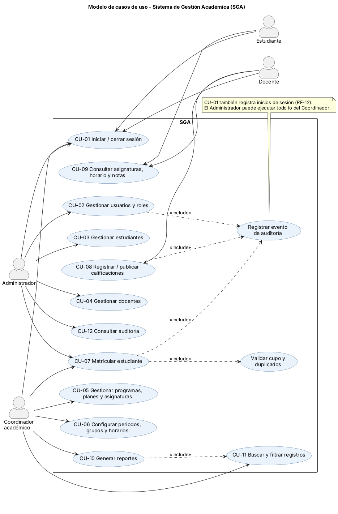
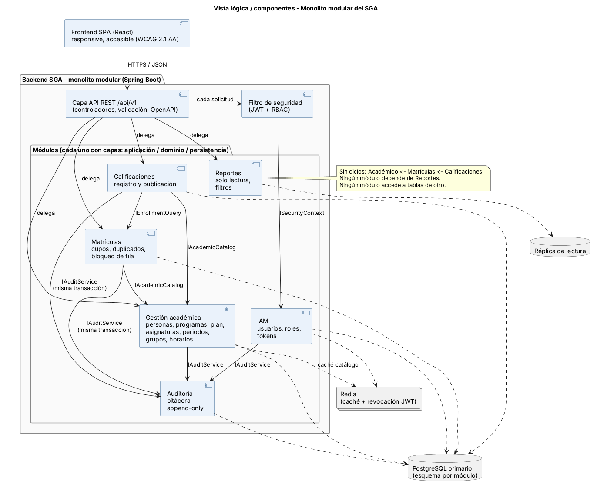
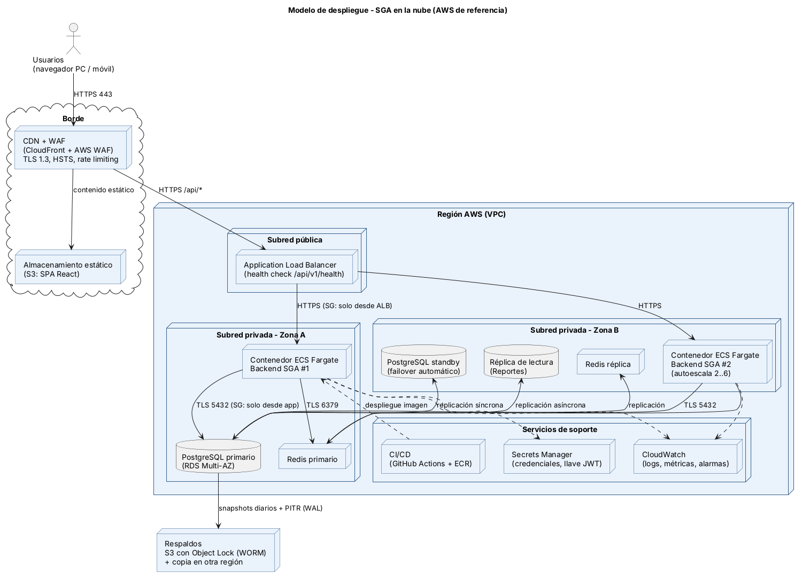
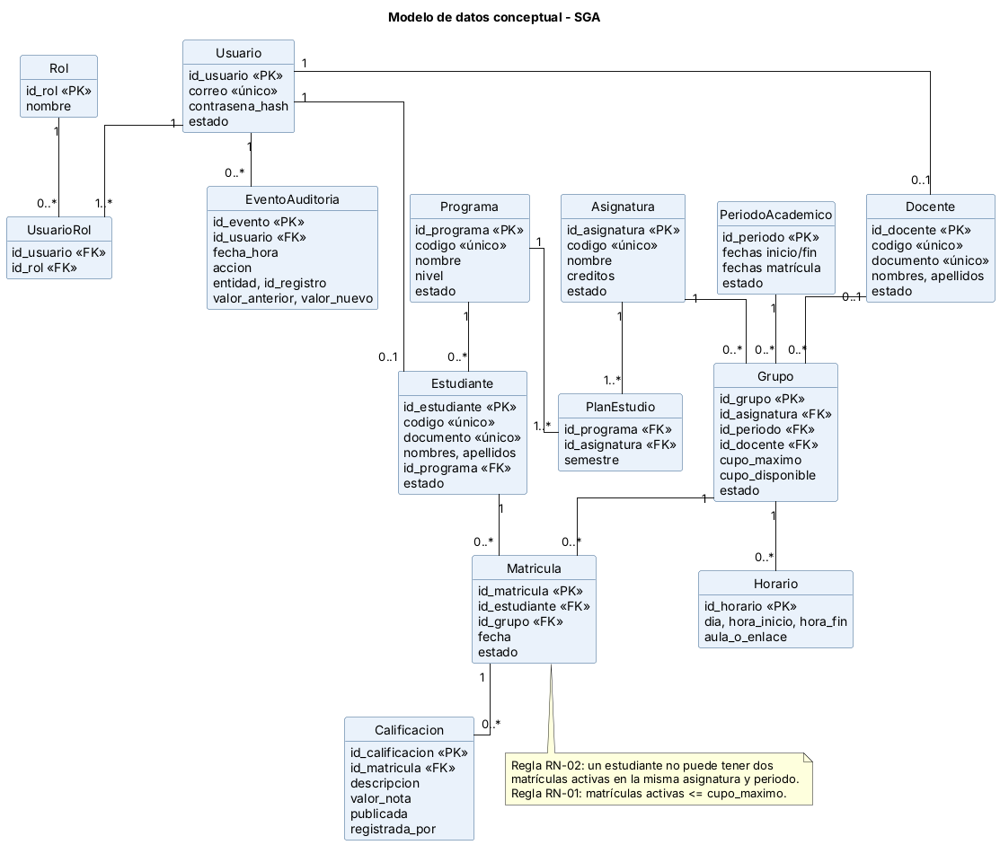
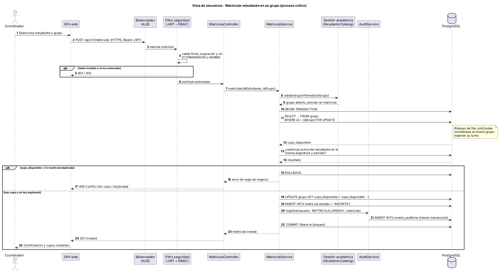

# Sistema de Gestión Académica (SGA) — Arquitectura de software

Trabajo final de **Arquitectura de Software (54451)**  
Estudiante: **Yessica Alejandra Carrascal** · Docente: **Alexander Calderón Martínez** · Noviembre de 2026

Video de socialización
https://www.youtube.com/watch?v=6joazVZA6F4

> Este repositorio contiene una **propuesta de arquitectura** (diseño y modelos). No incluye implementación de código.

## Resumen de la arquitectura
- **Estilo:** monolito modular con capas internas (API → aplicación → dominio → persistencia).
- **Módulos:** IAM (autenticación y roles) · Gestión académica · Matrículas · Calificaciones · Reportes · Auditoría.
- **Tecnologías de referencia:** React · Java 21 + Spring Boot · PostgreSQL · Redis · API REST con OpenAPI.
- **Despliegue:** AWS en 2 zonas de disponibilidad (CloudFront + WAF, ALB, ECS Fargate, RDS Multi-AZ, réplica de lectura, S3 con Object Lock).
- **Decisiones clave:** transacción ACID con bloqueo de fila para la matrícula, auditoría append-only en la misma transacción, JWT con RBAC y control por propietario.

## Contenido
| Carpeta | Descripción |
|---|---|
| `informe/` | Informe final en PDF y Word |
| `diagramas/` | Fuentes PlantUML (`.puml`) e imágenes (`.png`) de los 5 modelos |
| `evidencias_ai_studio/` | Capturas de Google AI Studio y análisis crítico (aceptado / modificado / descartado) |

## Diagramas
| Modelo | Fuente | Imagen |
|---|---|---|
| Casos de uso | [01_casos_de_uso.puml](diagramas/01_casos_de_uso.puml) |  |
| Componentes (vista lógica) | [02_componentes.puml](diagramas/02_componentes.puml) |  |
| Despliegue | [03_despliegue.puml](diagramas/03_despliegue.puml) |  |
| Datos conceptual | [04_modelo_datos.puml](diagramas/04_modelo_datos.puml) |  |
| Secuencia: matrícula | [05_secuencia_matricula.puml](diagramas/05_secuencia_matricula.puml) |  |

Para regenerar las imágenes: `java -jar plantuml.jar -tpng -charset UTF-8 diagramas/*.puml`

